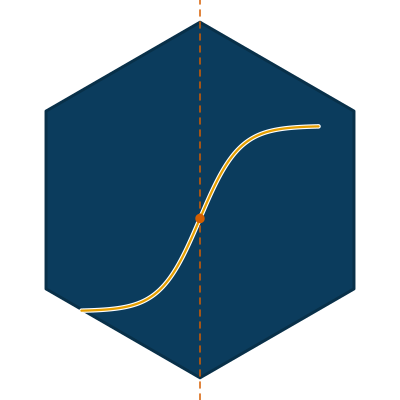

# epicurves 

Likelihood inference for epidemic curves. The package accompanies two
manuscripts in preparation derived from Jaciele Oliveira's doctoral thesis
(Programa de Pós-Graduação em Estatística, UFPE) and reproduces their
analyses.

- **Stochastic compartmental models under the Gaussian approximation.** Any
  mass-action model is declared by its events (`ga_model()`, `ga_event()`),
  observed through the incidence of events or the prevalence of compartments,
  with under-reporting and time-varying rates, and fitted by maximum
  likelihood with a Kalman filter (`ga_fit()`, `ga_profile()`,
  `ga_bootstrap()`). The SIRD model fitted to daily cases and deaths has a
  dedicated interface (`sird_ga_fit_inc()`, `sird_ga_fit_tv()`).
- **Growth-curve ensembles on daily counts.** Logistic, Gompertz and Richards
  curves are fitted by Poisson or negative binomial likelihood and combined
  with Akaike weights (`fit_ensemble_incidence()`); a series is divided into
  phases by penalised likelihood (`bic_segment()`) or by anytime-valid
  sequential e-detectors (`edetect_segment()`).

The `paraiba_covid19` dataset holds the COVID-19 surveillance series for
Paraíba, Brazil, used in both applications.

## Installation

```r
# install.packages("remotes")
remotes::install_github("Raydonal/epicurves")

# optional, needed by edetect_segment():
remotes::install_github("castlaboratory/edetect")
```

## Example

Declare a SIRD model, simulate reported cases and deaths, and fit it:

```r
library(epicurves)

sird <- ga_model(c("S", "I", "R", "D"), list(
  infection = ga_event("S", "I", rate = "lambda", by = "I"),
  recovery  = ga_event("I", "R", rate = "gamma"),
  death     = ga_event("I", "D", rate = "alpha")))
obs <- list(cases  = ga_incidence("infection", prob = "p", noise = "tau2"),
            deaths = ga_incidence("death", prob = 1, noise = "tau2_d"))

truth <- list(lambda = 0.6, gamma = 0.3, alpha = 0.1, p = 0.5, tau2 = 0.2, tau2_d = 0.1)
set.seed(1)
sim <- ga_simulate(sird, truth, c(S = 19990, I = 10, R = 0, D = 0), obs, n = 80)

init <- function(p) c(S = 1 - p$i0, I = p$i0, R = 0, D = 0)
fit <- ga_fit(sird, sim$data, obs, N = 20000, init = init,
              start = list(lambda = 0.5, gamma = 0.25, alpha = 0.15, i0 = 1e-3,
                           p = 0.6, tau2 = 0.3, tau2_d = 0.3))
confint(fit)
```

Divide the daily deaths in Paraíba into phases:

```r
data(paraiba_covid19)
seg <- bic_segment(paraiba_covid19$new_deaths, d_min = 12, family = "negbin", step = 5)
paraiba_covid19$date[seg$cuts]
```

The articles on the package website work through both methods in detail.
`NEWS.md` records the findings made while validating the package against the
thesis.
