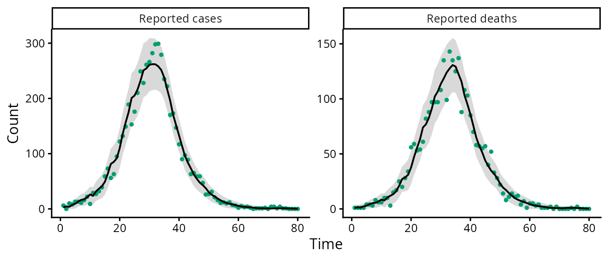

# Compartmental models from surveillance counts

``` r
library(epicurves)
```

This vignette shows how to declare a stochastic compartmental model,
simulate surveillance counts from it and fit it by maximum likelihood
under the Gaussian (linear noise) approximation of the Markov jump
process.

## Declaring a model

A model is a set of compartments and a named list of events. Each event
moves one individual from `from` to `to` at rate
`rate * x[from] * x[by]` (fractions of the population), or
`rate * x[from]` when `by` is omitted.

``` r
sird <- ga_model(c("S", "I", "R", "D"), list(
  infection = ga_event("S", "I", rate = "lambda", by = "I"),
  recovery  = ga_event("I", "R", rate = "gamma"),
  death     = ga_event("I", "D", rate = "alpha")))
sird
#> Mass-action compartmental model: S, I, R, D 
#>   infection    S -> I  at rate lambda * S * I
#>   recovery     I -> R  at rate gamma * I
#>   death        I -> D  at rate alpha * I
#> Rate parameters: lambda, gamma, alpha
```

## Observations

Surveillance counts are increments: new cases and new deaths in each
interval.
[`ga_incidence()`](https://raydonal.github.io/epicurves/reference/ga_incidence.md)
counts the firings of an event;
[`ga_prevalence()`](https://raydonal.github.io/epicurves/reference/ga_incidence.md)
counts the members of a compartment at the end of each interval.
Reported counts are a binomial thinning of the latent counts, with
probability `prob`, plus measurement error with variance `noise` times
the latent count. Either argument can be a parameter name or a fixed
number.

``` r
obs <- list(cases  = ga_incidence("infection", prob = "p", noise = "tau2"),
            deaths = ga_incidence("death", prob = 1, noise = "tau2_d"))
```

## Simulating and fitting

``` r
truth <- list(lambda = 0.6, gamma = 0.3, alpha = 0.1, p = 0.5, tau2 = 0.2, tau2_d = 0.1)
set.seed(1)
sim <- ga_simulate(sird, truth, c(S = 19990, I = 10, R = 0, D = 0), obs, n = 80)
colSums(sim$data)
#> incidence_infection     incidence_death 
#>                5722                2788
```

The initial state is given as a function of the parameters, so that the
initial fraction of infectious individuals can be estimated:

``` r
init <- function(p) c(S = 1 - p$i0, I = p$i0, R = 0, D = 0)
fit <- ga_fit(sird, sim$data, obs, N = 20000, init = init,
              start = list(lambda = 0.5, gamma = 0.25, alpha = 0.15, i0 = 1e-3,
                           p = 0.6, tau2 = 0.3, tau2_d = 0.3))
fit
#> Gaussian-approximation fit of a 4 compartment model
#> log-likelihood: 1112.5338 (1 start(s))
#>         estimate     lower    upper
#> lambda 0.6292000 0.5709000 0.693500
#> gamma  0.3170000 0.2795000 0.359400
#> alpha  0.0975000 0.0761100 0.124900
#> i0     0.0004313 0.0002739 0.000679
#> p      0.4842000 0.4352000 0.533400
#> tau2   0.2949000 0.1068000 0.814300
#> tau2_d 0.1692000 0.0155800 1.837000
plot(fit, labels = c("Reported cases", "Reported deaths"))
```



[`confint()`](https://rdrr.io/r/stats/confint.html) returns Wald
intervals computed on the scale of the optimisation (logarithms, or
logits for probabilities and initial fractions) and transformed back.
[`predict()`](https://rdrr.io/r/stats/predict.html) returns the
one-step-ahead predicted means and standard deviations of the counts.

## Rates that change over time

A rate parameter listed in `blocks` takes one value per block of
observation intervals. For two transmission rates of 40 days each:

``` r
fit_tv <- ga_fit(sird, sim$data, obs, N = 20000, init = init,
                 start = list(lambda = c(0.5, 0.5), gamma = 0.25, alpha = 0.15, i0 = 1e-3,
                              p = 0.6, tau2 = 0.3, tau2_d = 0.3),
                 blocks = list(lambda = rep(1:2, each = 40)))
```

## What the data identify

With cases only, the recovery and death rates enter the likelihood only
through their sum, so the death rate is not identifiable. A profile
likelihood shows this directly (not run here because each grid point is
a complete fit):

``` r
cases_only <- sim$data
cases_only[, 2] <- NA
fit_c <- ga_fit(sird, cases_only, obs, 20000, init,
                start = list(lambda = 0.5, gamma = 0.25, alpha = 0.15, i0 = 1e-3,
                             p = 0.6, tau2 = 0.3), fixed = list(tau2_d = 0.1))
ga_profile(fit_c, "alpha", grid = c(0.1, 0.05, 0.02, 0.15, 0.2))
```

## Other models

Any mass-action structure can be declared in the same way, for example a
SEIRD model with a latent compartment, or a SIRDV model with vaccination
observed through the number of doses:

``` r
seird <- ga_model(c("S", "E", "I", "R", "D"), list(
  infection   = ga_event("S", "E", "lambda", by = "I"),
  progression = ga_event("E", "I", "sigma"),
  recovery    = ga_event("I", "R", "gamma"),
  death       = ga_event("I", "D", "alpha")))
sirdv <- ga_model(c("S", "I", "R", "D", "V"), list(
  infection   = ga_event("S", "I", "lambda", by = "I"),
  recovery    = ga_event("I", "R", "gamma"),
  death       = ga_event("I", "D", "alpha"),
  vaccination = ga_event("S", "V", "nu")))
```
